# coc-v18-offline

a clash of clans **18.0.5** offline mode client for android. based on clash of magic (which is based on atrasis lol).

## features

- home village and builder base, upgrades, armies and layout editing
- auto saving
- offline clans: create, search, join, chat, clan mail and member management
- name change and commands for levels, gems, trophies, leagues and town hall presets
- **65 sceneries and 216 skins unlocked**
- magic items, resource refills, trader and Gold Pass
- single-player maps, multiplayer-style attacks and builder base battles
- friends, player profiles, visits and leaderboards

type `/help` in clan chat to see the commands. some examples:

```text
/name NewName
/th 17
/max
/save
/reload
```

## tested

tested on an **android 11 emulator** running the 32-bit ARM client through ARM translation.

## screenshots

| village | saved village |
| --- | --- |
| 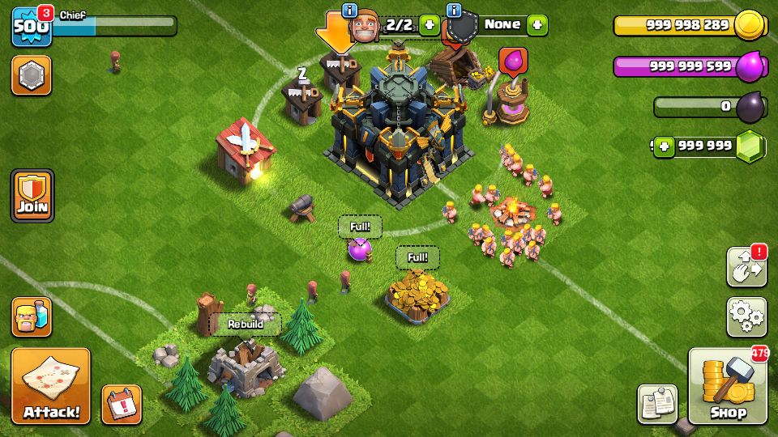 | 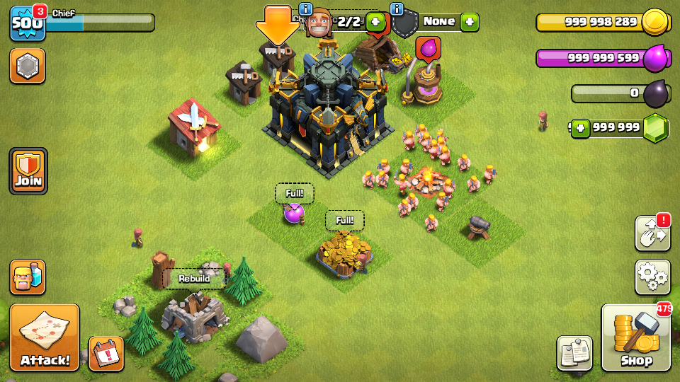 |
| layout editor | name change |
| 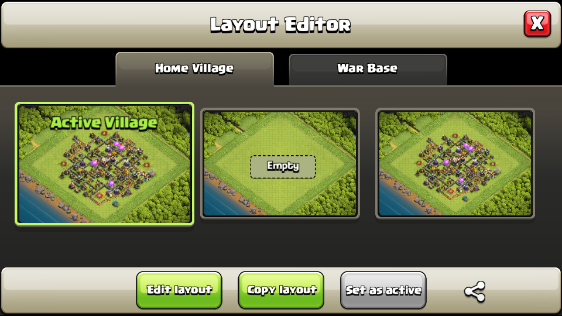 | 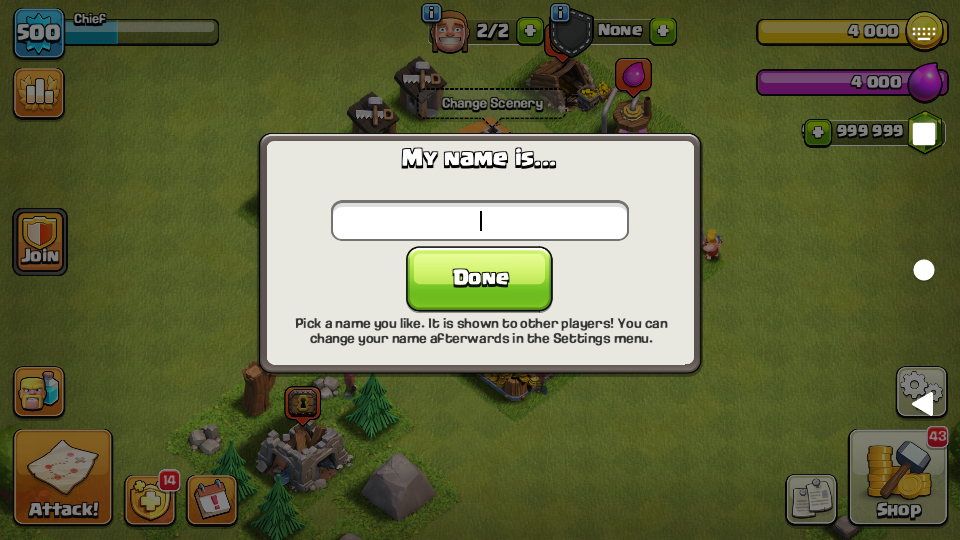 |
| sceneries | skins |
| 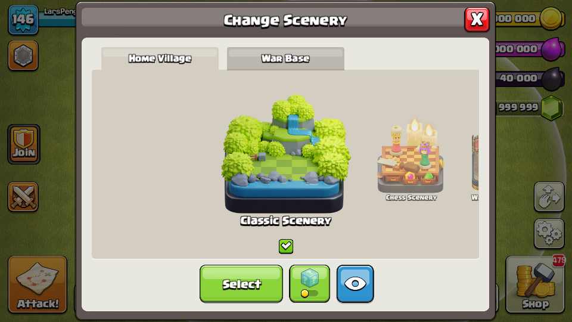 | 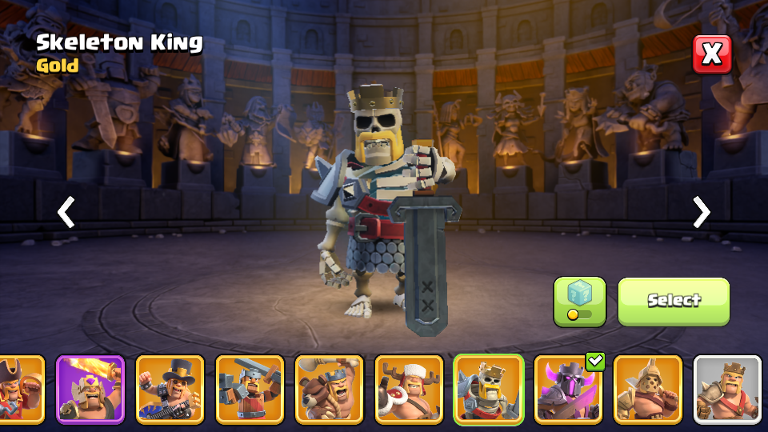 |
| magic items | clans |
| 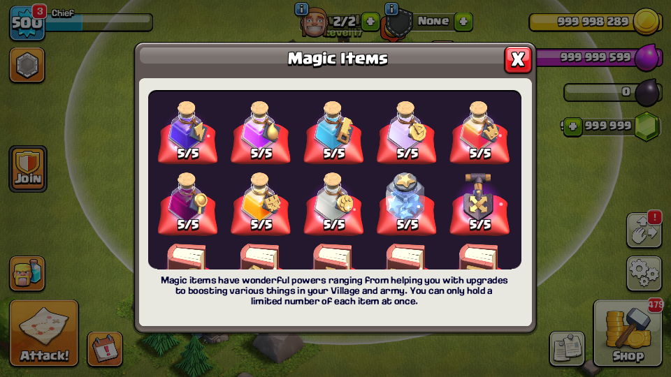 | 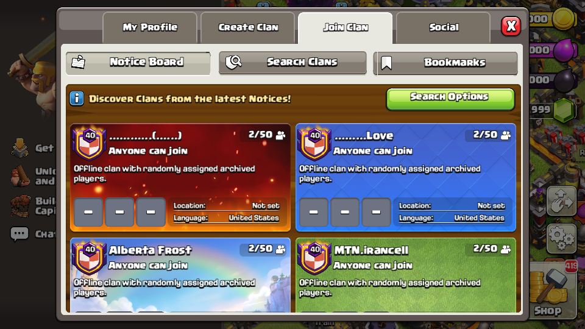 |
| clan management | clan chat and commands |
| 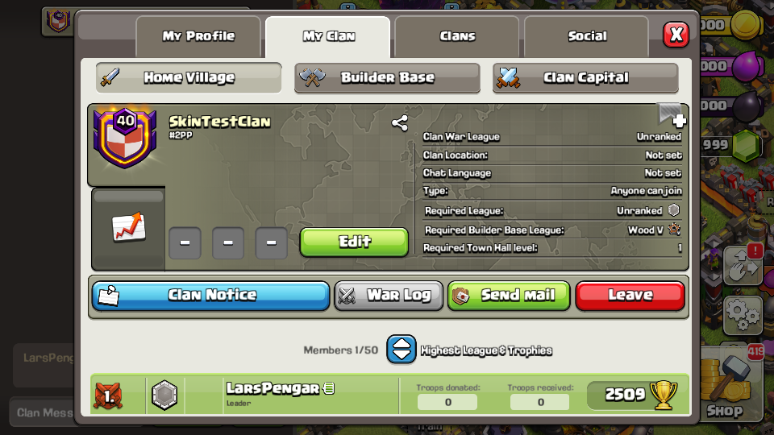 | 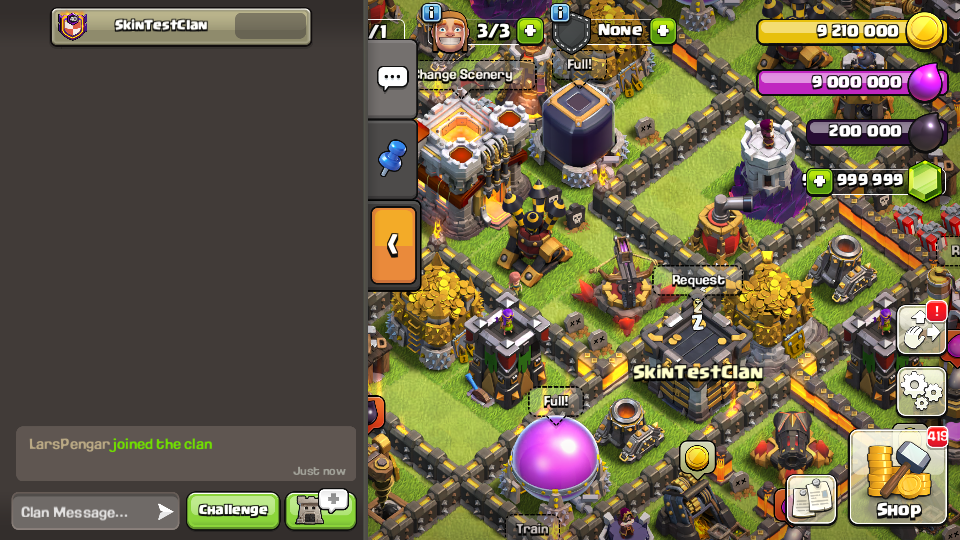 |
| clan mail | member roles |
| 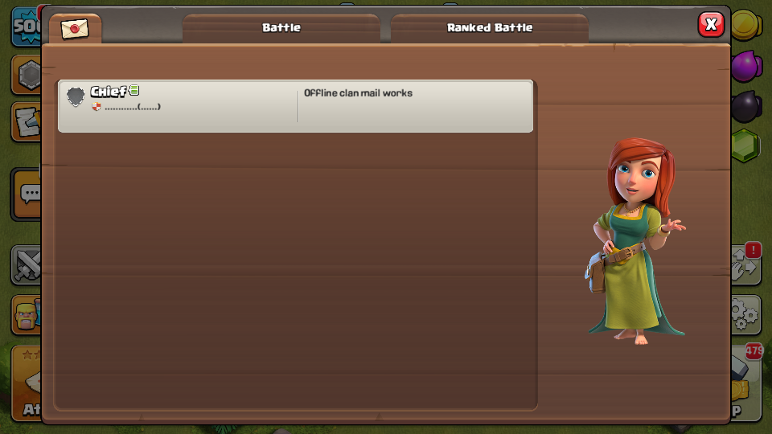 | 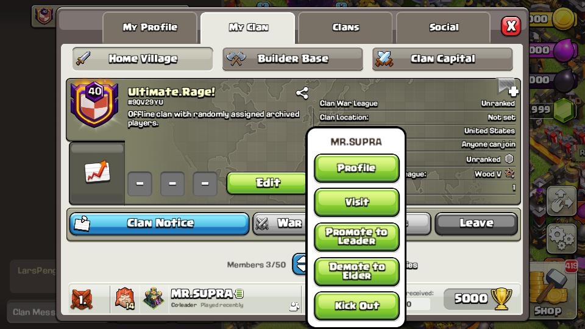 |
| multiplayer | single-player attack |
| 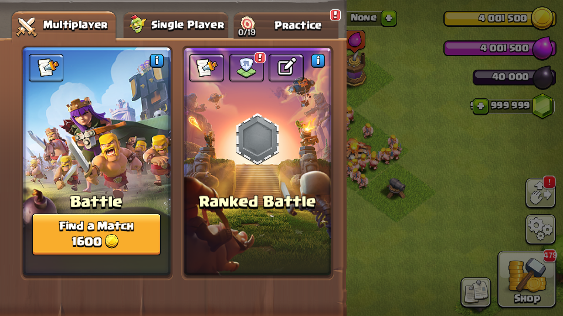 | 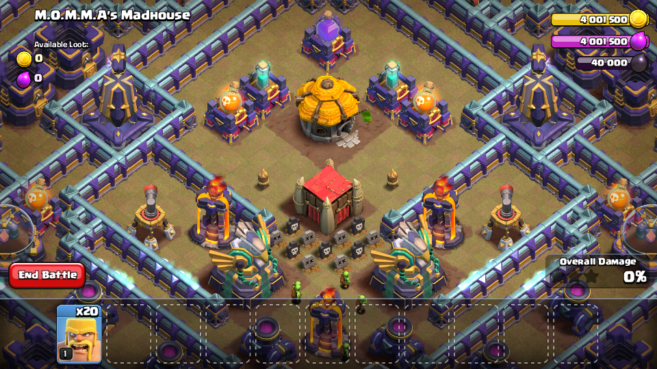 |
| builder base | builder base battle |
| 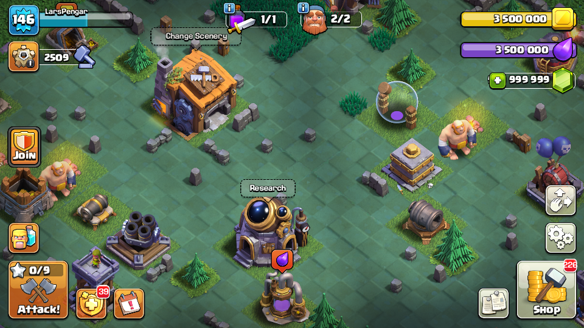 | 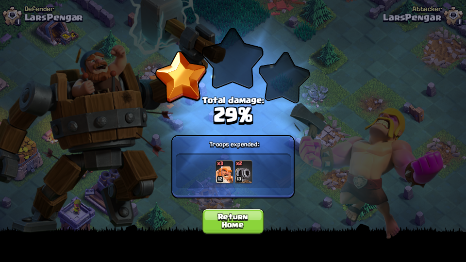 |
| leaderboards | friends |
| 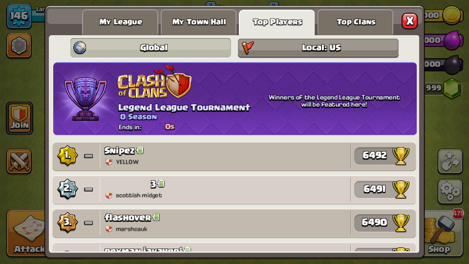 | 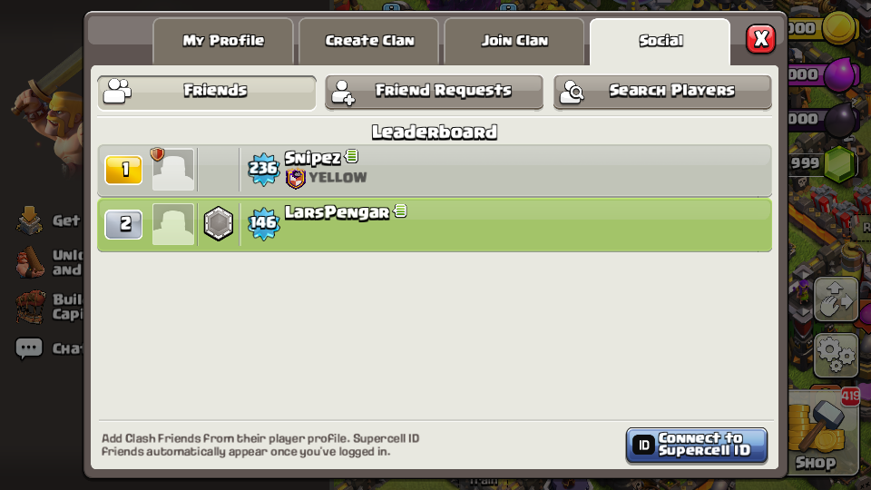 |

## download

[download clash of clans v18.0.5 offline.apk](https://github.com/8133/coc-v18-offline/releases/download/v18.0.5/Clash.of.Clans.v18.0.5.offline.apk)

this whole thing was done using AI.
